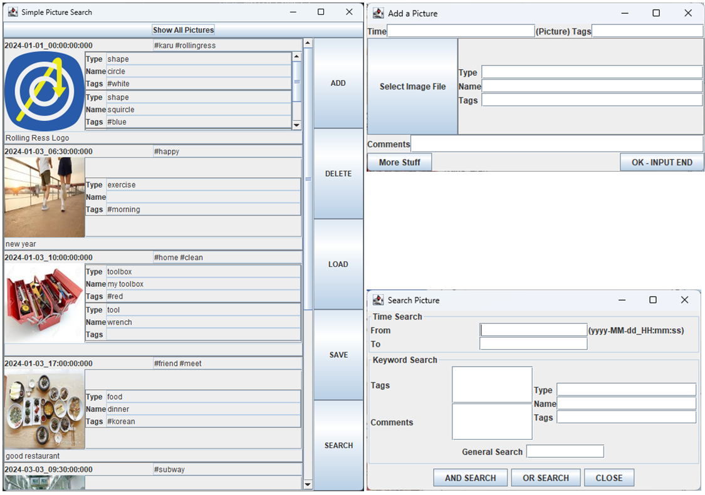
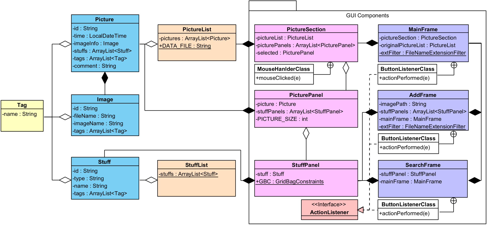

# [CAU] Software Project
<!-- Overview -->
This repository contains assignments for the **[49148] Software Project** course at Chung-Ang University in Spring 2024. The assignments cover Java execution-time measurement, Java and C-style programming comparisons, generic data structures, and the development of a Picture Search application with GUI and event handling.

<!-- ## Features : for project-based repository -->

## Course Information

| Field | Details |
|---|---|
| **Course Title** | Software Project (소프트웨어프로젝트) |
| **Institution** | Chung-Ang University |
| **Department** | School of Computer Science and Engineering |
| **Semester** | Spring 2024 |
| **Grade** | A+ |

## Assignments

| Assignment | Topic | Description |
|---|---|---|
| [Assignment 1](./assignment-1/) | Measure Execution Time | Measure the execution time of Java methods |
| [Assignment 2](./assignment-2/) | Java and C-style Programming | Compare Java programs with C-style implementations |
| [Assignment 3](./assignment-3/) | Picture Search CLI | Picture/Stuff Search Program |
| [Assignment 4](./assignment-4/) | Generic ArrayList | Implement array-list data structures, including a generic `MyArrayList<E>`. |
| [Assignment 5](./assignment-5/) | Picture Search GUI | Develop a graphical user interface for the Picture Search application. |
| [Assignment 6](./assignment-6/) | Picture Search Application | Integrate event handling and application functionality into the Picture Search GUI. |
| [Final](./final/) | Refactored Picture Search | Refactor the Picture Search application with targeted code-structure improvements. |

Each assignment directory contains its own source code and README with project-specific details and instructions.

## Requirements
- JDK 21
- Java Swing (for GUI-based assignments, included in the JDK)

## Getting Started
  
<!-- for subject-based, specific installation method should be post on internal README files -->
1. Clone this repository.
2. Navigate to the directory of the assignment you want to explore.
3. Configure JDK 21 in your development environment.
4. Follow the instructions in that directory's README to compile and run the project.

<!-- ## Usage -->
<!-- for subject-based repo, use ### to designate a program -->

## Project Structure
```
.
├── assets/
├── assignment-1/
├── assignment-2/
├── assignment-3/
├── assignment-4/
├── assignment-5/
├── assignment-6/
├── final/
└── README.md
```
- `assignment-1/` – Java execution-time measurement
- `assignment-2/` – Java and C-style programming comparison
- `assignment-3/` – Command-line Picture Search application
- `assignment-4/` – Array-list implementations and generic programming
- `assignment-5/` – Picture Search GUI
- `assignment-6/` – Picture Search application with event handling
- `final/` – Refactored version of the Picture Search application
- `assets/` – Repository-level images and other documentation assets

## Architecture

Assignments 3, 5, and 6 develop different parts of the Picture Search application, progressing from command-line functionality to a graphical interface and event handling.

The main components include:

- **Data model:** `Tag`, `Picture`, `Image`, and `Stuff`
- **Data collections:** `PictureList` and `StuffList`
- **GUI components:** `MainFrame`, `PictureSection`, `PicturePanel`, and `StuffPanel`
- **Application windows:** `AddFrame` and `SearchFrame`

The exact components and functionality vary by assignment. See the README in each relevant directory for implementation details.

  

<!-- ## Implementation Details --> <!-- Algorithms, Design decisions, why implemented in such way... -->

<!-- ## Documentation -->

<!-- ## Licnese -->

<!-- ## Acknowledgements : libraries used, references, etc -->

