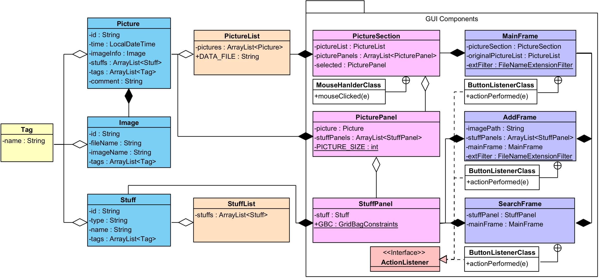

# [CAU] Software Project (JAVA)

<table>
  <tr>
    <th colspan="4">&lt;소프트웨어 프로젝트> 과목 정보</th>
  </tr>
  <tr>
    <td><b>개설대학</b></td><td>소프트웨어대학</td>
    <td><b>개설학과</b></td><td>소프트웨어학부</td>
  </tr>
  <tr>
    <td><b>대상학년</b></td><td>2학년</td>
    <td><b>이수구분</b></td><td>전공선택</td>
  </tr>
  <tr>
    <td><b>과목유형</b></td><td>이론강의</td>
    <td><b>영어강의</b></td><td>-</td>
  </tr>
  <tr>
    <td><b>이수학점</b></td><td>3학점</td>
    <td><b>강의시간</b></td><td>3시간</td>
  </tr>
  <tr>
    <th colspan="4">공학교육인증 교과목 정보</th>
  </tr>
  <tr>
    <td><b>공학인증</b></td><td>공학주제</td>
    <td><b>설계학점</b></td><td>1학점</td>
  </tr>
  <tr>
    <th colspan="4">이수 내역</th>
  </tr>
  <tr>
    <td><b>이수학기</b></td><td>2-1</td>
    <td><b>취득평점</b></td><td>A+(4.5)</td>
  </tr>
</table>

## GUI Picture Search

### Class Design

- Tag (태그 정보)
- Picture (사진 정보)
- Image (이미저 정보)
- Stuff (사물 정보)
- PictureList (Picture의 리스트)
- StuffList (사물 정보 데이터베이스)
- PictureSection (PictureList의 GUI)
- PicturePanel (Picture의 GUI)
- StuffPanel (Stuff의 GUI)
- MainFrame (메인 화면)
- AddFrame (사진 추가 화면)
- SearchFrame (사진 검색 화면)
